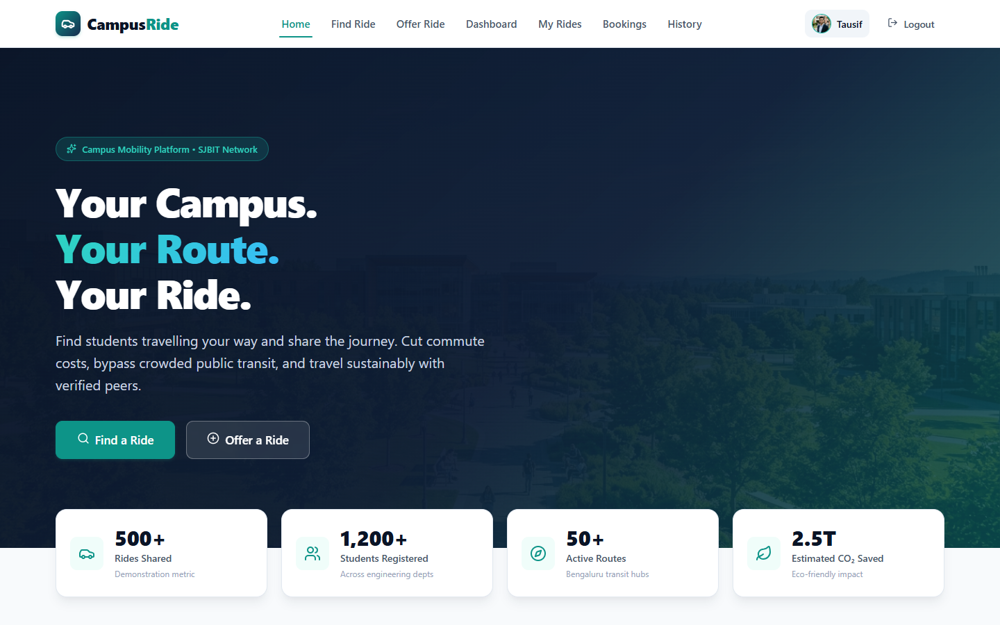
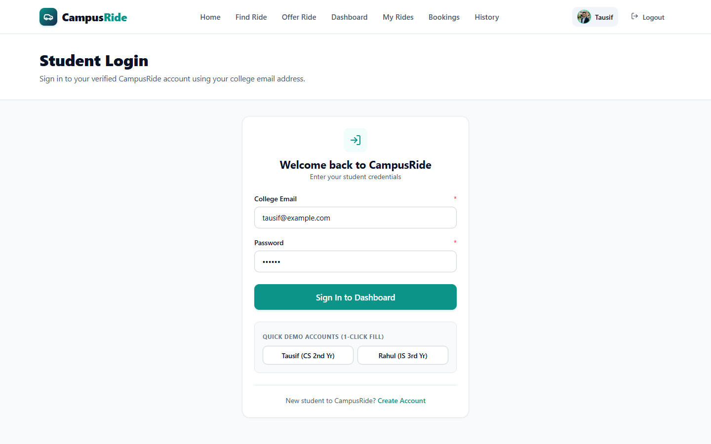
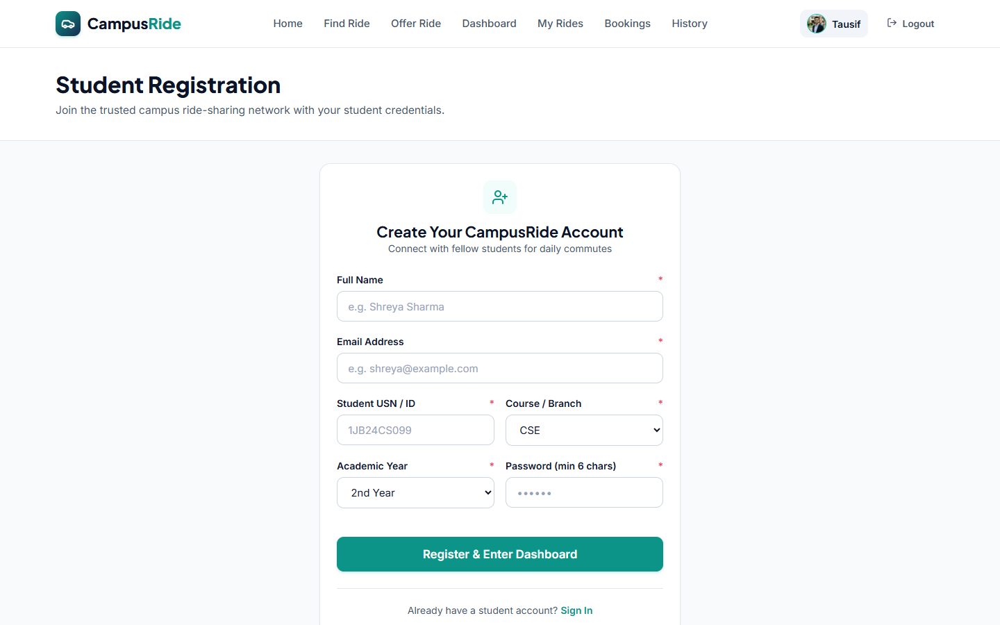
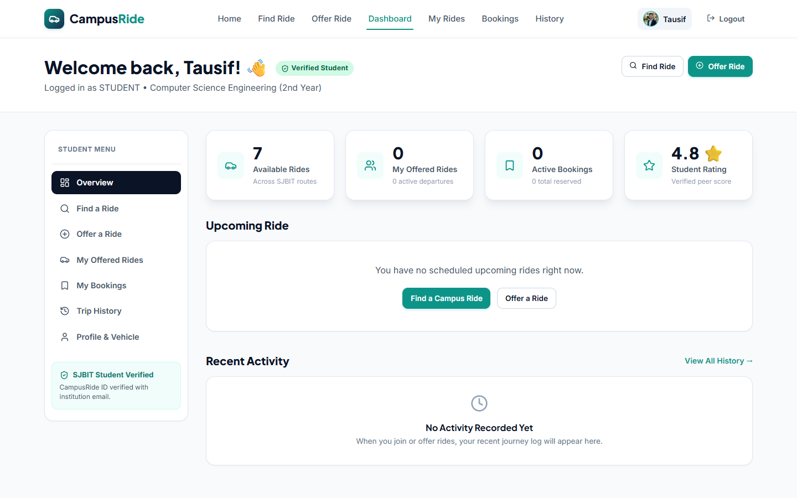
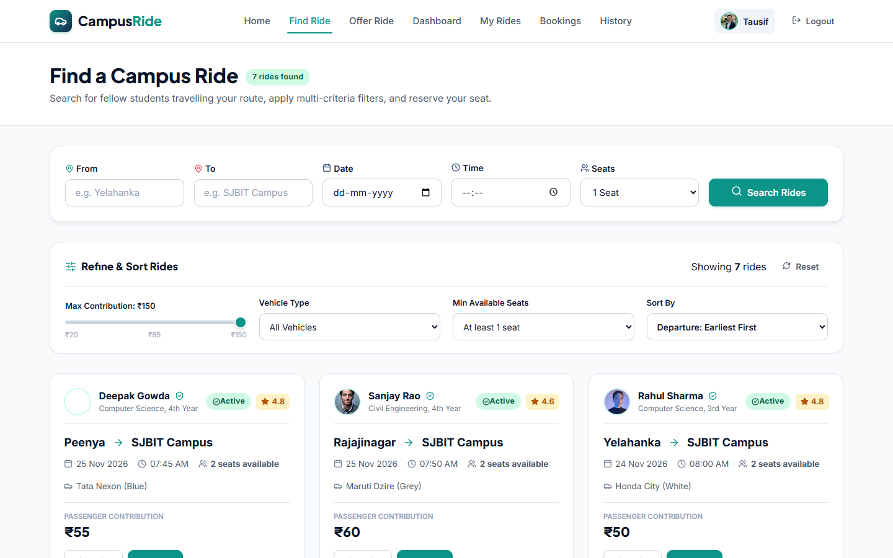
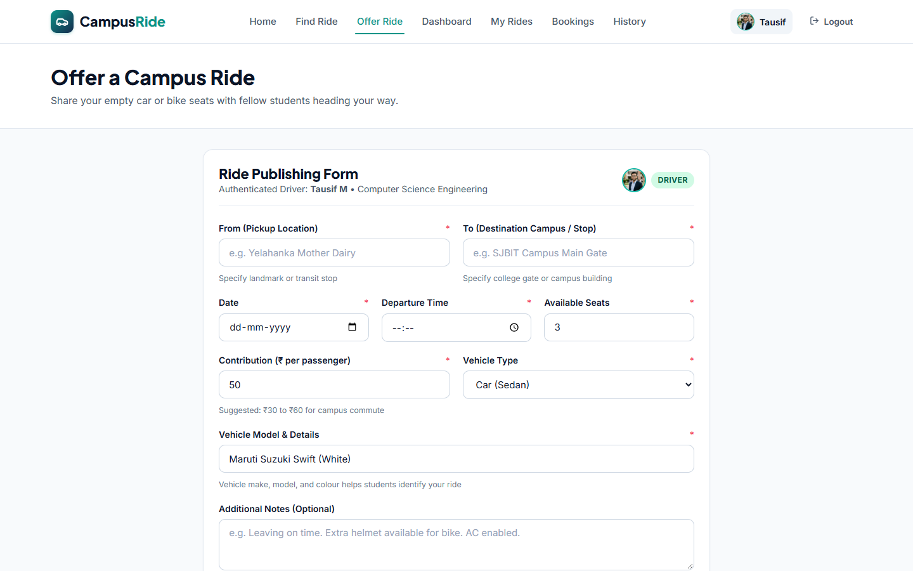
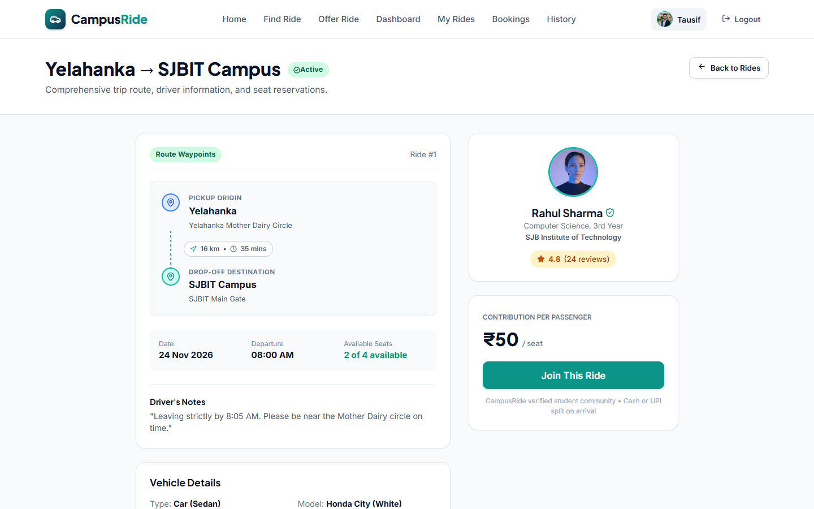
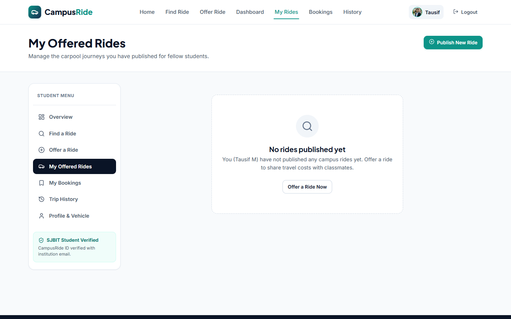
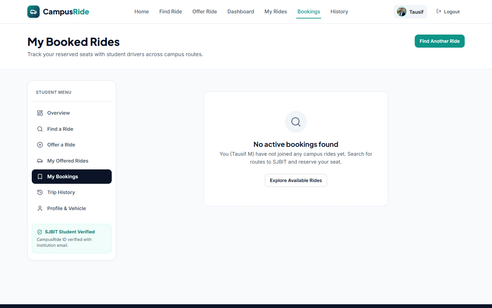
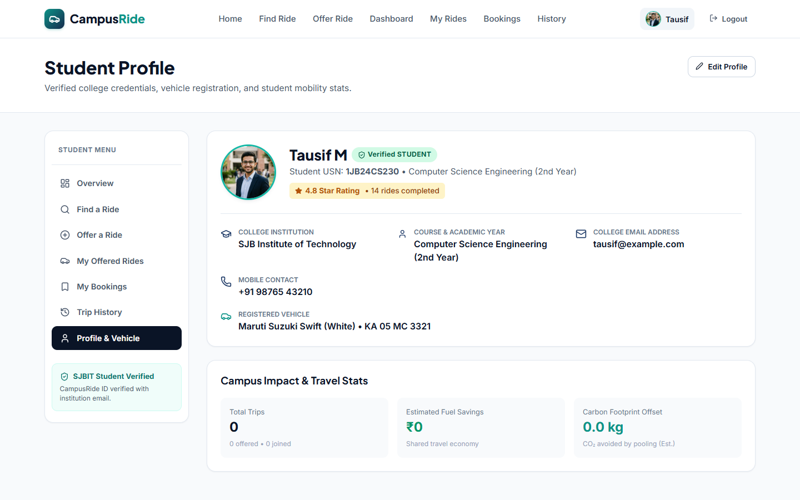

# 🚗 CampusRide

### College Carpool & Ride Sharing Platform

**CampusRide** is a React-based college carpool and ride-sharing web application designed to help students travelling along similar routes share rides, reduce individual travel costs, and make campus transportation more convenient.

The application allows students to **offer rides, search for available rides, join rides, manage bookings, track ride history, and maintain their student profiles** through a responsive web interface.

---

## 🌐 Project Repository

**GitHub:**  
https://github.com/tausifm2174-cyber/CampusRide

---

## 📌 Problem Statement

Students travelling to and from college often use separate vehicles even when they live along similar routes. This can result in:

- Higher transportation costs
- Increased fuel consumption
- Unused vehicle capacity
- Difficulty finding students travelling on the same route
- Lack of a centralized platform for campus ride sharing

CampusRide addresses this problem by providing a centralized platform where students can **offer, discover, and join rides** based on route, date, time, available seats, vehicle type, and contribution amount.

---

## 🎯 Objectives

The main objectives of CampusRide are to:

- Provide a platform for students to share rides.
- Allow students to create and offer rides.
- Help students find rides matching their route and requirements.
- Allow passengers to reserve available seats.
- Display driver and ride information clearly.
- Manage bookings and cancellations.
- Provide ride history and activity information.
- Provide student profile management.
- Demonstrate modern React JS concepts through a practical application.
- Provide a responsive interface suitable for different screen sizes.

---

## ✨ Key Features

### 🔐 Student Authentication

- Student registration
- Student login
- Logout
- Persistent login using browser storage
- Protected application routes
- Login validation
- Duplicate email validation

### 🚘 Offer a Ride

Students can create rides by providing information such as:

- Starting location
- Destination
- Date
- Time
- Number of seats
- Contribution amount
- Vehicle type
- Vehicle model
- Additional notes

### 🔎 Find a Ride

Students can search and filter available rides using:

- Route
- Date
- Time
- Required seats
- Price range
- Vehicle type
- Available seats

Rides can also be sorted by:

- Earliest departure
- Lowest contribution
- Highest contribution
- Available seats
- Driver rating

### 🪑 Join a Ride

Students can join available rides and reserve a seat.

The application automatically updates:

- Booked seats
- Available seats
- Booking information
- Ride status

### 📋 Booking Management

Students can:

- View their active bookings
- View booking information
- Cancel bookings
- Restore the corresponding available seat after cancellation

### 🚦 Ride Management

Ride owners can:

- View their offered rides
- Edit rides
- Cancel rides
- View ride status
- Manage available seats

### ⭐ Ratings & Reviews

Students can rate completed rides using a **1–5 star rating system** and optionally provide feedback.

Driver ratings are updated based on submitted ride ratings.

### 🗺️ Route Preview

Ride details include a visual route representation showing:

**Starting Point → Route → Destination**

The route visualization is implemented within the application without requiring an external Maps API.

### 🔔 Notifications

CampusRide provides in-app notifications for important actions such as:

- Successful ride creation
- Successful booking
- Booking cancellation
- Ride cancellation
- Validation errors
- Profile updates
- Other application events

### 📊 Dashboard

The dashboard provides an overview of student activity, including:

- Available rides
- Offered rides
- Active bookings
- Student rating
- Upcoming ride
- Recent activity

### 👤 Student Profile

Students can manage and view:

- Name
- Email
- USN
- Department
- Year
- Profile image
- Ride statistics
- Travel-related activity

### 📱 Responsive Design

The application is designed to work across:

- Mobile phones
- Tablets
- Laptops
- Desktop computers
- Large displays

Responsive layouts are implemented for navigation, forms, cards, tables, filters, dashboards, dialogs, and other interface components.

---

## 🛠️ Technology Stack

| Technology | Purpose |
|---|---|
| **React JS** | Frontend application development |
| **JavaScript** | Application logic |
| **JSX** | UI structure |
| **CSS3** | Styling and responsive design |
| **React Router** | Client-side navigation |
| **Context API** | Global application state |
| **useReducer** | Centralized ride/booking state management |
| **useState** | Local component state |
| **useEffect** | Side effects and persistence |
| **Custom Hooks** | Reusable application logic |
| **localStorage** | Client-side data persistence |
| **Vite** | Development and build tool |
| **Git & GitHub** | Version control and repository hosting |

---

## 🧠 React Concepts Demonstrated

CampusRide was developed to demonstrate practical React JS concepts.

### Components

The application uses reusable functional components such as:

```text
Header
Footer
Sidebar
Button
SearchBar
RideCard
StatusBadge
FormInput
SelectInput
StatisticCard
PageHeader
EmptyState
Notification
FilterPanel
RoutePreview
RatingModal
```

### Props

Props are used to pass information between components.

For example:

```jsx
<RideCard ride={ride} />
```

### State

React state is used for dynamic application data such as:

- Search values
- Form inputs
- Selected filters
- Ride information
- Booking information
- Authentication state
- Modal visibility
- Notifications

### Context API

Context API is used for application-wide state such as:

- Authentication
- Ride data
- Bookings
- Notifications

### useReducer

The ride and booking system uses a reducer-based architecture for predictable state updates.

Example actions include:

```text
ADD_RIDE
EDIT_RIDE
CANCEL_RIDE
JOIN_RIDE
CANCEL_BOOKING
RATE_RIDE
```

### Custom Hooks

Custom hooks provide reusable logic such as:

```text
useAuth()
useRides()
useNotification()
useLocalStorage()
```

### React Router

React Router is used to provide navigation between application pages.

---

## 🏗️ Application Architecture

The application follows a component-based React architecture.

```text
                    CampusRide
                        │
                        ▼
                   React App
                        │
          ┌─────────────┴─────────────┐
          │                           │
      Authentication              Application
          │                           │
      AuthContext                RideContext
          │                           │
          │                       useReducer
          │                           │
          │                    ┌──────┴──────┐
          │                    │             │
          │                  Rides        Bookings
          │
          └──────────────┐
                         │
                  Protected Routes
                         │
        ┌────────────────┼────────────────┐
        │                │                │
     Dashboard        Find Ride       Offer Ride
        │                │                │
     Bookings        Ride Details      My Rides
        │                │                │
     History          Profile           Other UI
```

---

## 📁 Project Structure

The project follows a modular React structure.

```text
CampusRide/
│
├── public/
│   ├── assets/
│   │   ├── campus-background.jpg
│   │   ├── carpool-illustration.png
│   │   ├── student-driver.jpg
│   │   └── carpool-drive.jpg
│   │
│   └── screenshots/
│       ├── home.png
│       ├── login.png
│       ├── register.png
│       ├── dashboard.png
│       ├── find-ride.png
│       ├── offer-ride.png
│       ├── ride-details.png
│       ├── my-rides.png
│       ├── bookings.png
│       └── profile.png
│
├── src/
│   ├── components/
│   │   ├── Button.jsx
│   │   ├── Header.jsx
│   │   ├── Footer.jsx
│   │   ├── RideCard.jsx
│   │   ├── SearchBar.jsx
│   │   ├── FilterPanel.jsx
│   │   ├── StatusBadge.jsx
│   │   ├── Notification.jsx
│   │   ├── RoutePreview.jsx
│   │   ├── RatingModal.jsx
│   │   └── ...
│   │
│   ├── context/
│   │   ├── AuthContext.jsx
│   │   ├── RideContext.jsx
│   │   └── NotificationContext.jsx
│   │
│   ├── hooks/
│   │   ├── useAuth.js
│   │   ├── useRides.js
│   │   ├── useNotification.js
│   │   └── useLocalStorage.js
│   │
│   ├── reducers/
│   │   └── rideReducer.js
│   │
│   ├── pages/
│   │   ├── Home.jsx
│   │   ├── Login.jsx
│   │   ├── Register.jsx
│   │   ├── Dashboard.jsx
│   │   ├── FindRide.jsx
│   │   ├── OfferRide.jsx
│   │   ├── RideDetails.jsx
│   │   ├── MyRides.jsx
│   │   ├── Bookings.jsx
│   │   ├── History.jsx
│   │   └── Profile.jsx
│   │
│   ├── data/
│   │   └── mockRides.js
│   │
│   ├── App.jsx
│   ├── main.jsx
│   └── index.css
│
├── index.html
├── package.json
├── vite.config.js
└── README.md
```

> The exact file structure may evolve as the project is maintained.

---

## 💾 Data Persistence

CampusRide is a **frontend-only application**.

Application data is persisted using the browser's `localStorage`.

The application stores information such as:

```text
campusride_current_user
campusride_users
campusride_rides
campusride_bookings
```

This allows the application to preserve authentication, rides, and bookings across browser refreshes.

---

## 🔄 Ride Management Workflow

The basic ride-sharing workflow is:

```text
Student Login
      │
      ▼
Create / Search Ride
      │
      ├───────────────┐
      │               │
      ▼               ▼
Offer Ride        Find Ride
      │               │
      │               ▼
      │          View Details
      │               │
      │               ▼
      │          Join Ride
      │               │
      └───────┬───────┘
              ▼
        Booking Created
              │
              ▼
       Ride Participation
              │
              ▼
         Complete Ride
              │
              ▼
        Rate the Ride
```

---

## 🔐 Demo Account

For demonstration purposes, the application includes a demo student account.

```text
Email:    tausif@example.com
Password: 123456
```

> **Note:** This is a frontend demonstration account. No production authentication service or backend server is connected.

---

## 🚀 Getting Started

### Prerequisites

Make sure the following are installed:

- Node.js
- npm
- Git

You can verify the installations using:

```bash
node --version
npm --version
git --version
```

---

### 1. Clone the Repository

```bash
git clone https://github.com/tausifm2174-cyber/CampusRide.git
```

Move into the project directory:

```bash
cd CampusRide
```

---

### 2. Install Dependencies

```bash
npm install
```

---

### 3. Start the Development Server

```bash
npm run dev
```

Vite will start the development server.

Open the local URL shown in the terminal, normally:

```text
http://localhost:5173
```

---

### 4. Build for Production

To create a production build:

```bash
npm run build
```

---

### 5. Run Linting

To check the project for linting errors:

```bash
npm run lint
```

---

## 🧪 Testing

The application has been tested across the major user workflows.

### Authentication Testing

- Student registration
- Student login
- Invalid login
- Logout
- Persistent authentication
- Protected routes

### Ride Testing

- Create ride
- Search ride
- Filter rides
- Sort rides
- View ride details
- Join ride
- Seat availability update
- Edit ride
- Cancel ride

### Booking Testing

- Create booking
- View booking
- Cancel booking
- Restore available seat

### Rating Testing

- Submit ride rating
- Calculate updated rating
- Prevent duplicate rating submission

### Responsive Testing

The interface is designed for multiple viewport sizes, including:

```text
320 × 568
360 × 800
390 × 844
430 × 932
768 × 1024
1024 × 768
1280 × 720
1366 × 768
1440 × 900
1920 × 1080
2560 × 1440
```

---

## 📸 Screenshots

Real application screenshots captured from the live CampusRide platform:

### 🏠 Home Page
*Landing page with hero branding, quick search, statistics, and platform benefits.*



### 🔐 Student Login
*Secure login interface with persistent authentication and demo credentials.*



### 📝 Student Registration
*Registration interface with college USN, department, and academic year fields.*



### 📊 Student Dashboard
*Personalized student portal showing active rides, bookings, ratings, and recent activity.*



### 🔎 Find a Ride
*Interactive search and filter panel with price slider, vehicle type, and sorting controls.*



### 🚘 Offer a Ride
*Comprehensive ride publication form with vehicle specifications, seats, and route details.*



### 📋 Ride Details & Route Preview
*Detailed commute view featuring driver profile, vehicle details, route timeline, and one-click join.*



### 🚗 My Rides (Driver Management)
*Driver interface displaying offered rides, booked passenger counts, and ride actions.*



### 🎫 Bookings (Passenger View)
*Passenger interface for managing confirmed bookings and seat cancellations.*



### 👤 Student Profile
*Student profile management with academic details, contact information, and commute statistics.*



---

## 📚 Academic Purpose

CampusRide was developed as a **React JS academic project** to demonstrate the practical implementation of modern frontend development concepts.

The project combines:

- Component-based development
- Functional components
- Props
- State management
- Context API
- Reducers
- Custom Hooks
- Event handling
- Conditional rendering
- React Router
- Form handling
- Client-side persistence
- Responsive web design

---

## ⚠️ Limitations

The current version of CampusRide is a frontend-focused academic implementation.

The following are not implemented:

- Backend server
- Production database
- Real-time GPS tracking
- Real map integration
- Online payment gateway
- Real-time chat
- Push notifications
- Production-grade authentication
- Live ride tracking

Ride, booking, and user data are currently managed using browser `localStorage`.

---

## 🔮 Future Enhancements

CampusRide can be extended with:

- Node.js/Express backend
- MongoDB or MySQL database
- Secure authentication
- Google Maps or OpenStreetMap integration
- Real-time GPS tracking
- Online payment integration
- Real-time chat between students
- Push notifications
- Ride recommendations
- Driver verification
- Emergency/SOS functionality
- Admin dashboard
- Cloud deployment
- Mobile application

---

## 👥 Contributors

### Tausif M

**Computer Science & Engineering**

GitHub:  
https://github.com/tausifm2174-cyber

---

## 📄 License

This project was developed as an academic project.

Unless otherwise specified, the source code is intended primarily for educational and demonstration purposes.

---

## ⭐ Acknowledgement

CampusRide was developed using React JS and related frontend technologies as part of an academic project focused on applying modern web development concepts to a real-world transportation problem.

---

## 📌 Project Status

**Status: Completed — Academic Project**

The current implementation includes authentication, ride management, booking management, ratings, notifications, responsive design, Context API, useReducer, custom hooks, and browser-based persistence.

---

## 🔗 Repository

**CampusRide on GitHub:**  
https://github.com/tausifm2174-cyber/CampusRide
